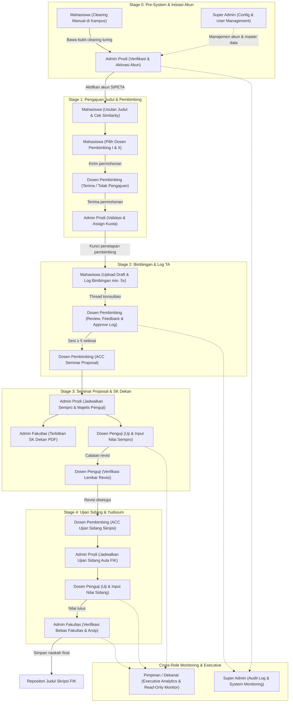

# Dokumentasi Arsitektur Berkas & Alur Kerja End-to-End 7 Role SIPETA

**Sistem Informasi Perjalanan & Evaluasi Tugas Akhir (SIPETA)**  
Fakultas Ilmu Komputer, Universitas Putra Indonesia YPTK Padang  
*Versi Dokumentasi:* 2.0 (Analisis Kompleksitas Berkas, Pemetaan 39 Rute, & Diagram Interkoneksi Role)  
*Tanggal:* 30 Juli 2026  

---

## 📂 1. Inventarisasi & Struktur Berkas Repository

SIPETA dibangun menggunakan **Next.js 14 App Router** dengan pendekatan **Fit-Viewport Architecture (`100dvh`)** dan Tailwind CSS. Aplikasi ini memuat **39 Rute Halaman** yang terbagi dalam **7 Role Utama**:

```
sipeta-upiyptk/
├── docs/                        # Dokumentasi Sistem & Spesifikasi
│   ├── TASKS.md                 # Checklist & Roadmap Audit Sub-Halaman
│   ├── ROLES.md                 # Spesifikasi 7 Role & RBAC Matrix
│   ├── PRD.md                   # Product Requirement Document
│   ├── WORKFLOWS.md             # Alur Kerja Operasional & Siklus TA
│   ├── DATABASE.md              # Skema Prisma & Entitas DB
│   ├── STYLEGUIDE.md            # Tokens, Tipografi & Design System
│   ├── fit-viewport-layout.md   # Spesifikasi Arsitektur Viewport 100dvh
│   └── ARCHITECTURE_AND_WORKFLOWS.md # Dokumen Arsitektur & Alur Kerja Ini
│
└── frontend/src/
    ├── app/                     # App Router — 39 Rute Halaman (7 Role)
    │   ├── page.tsx             # Dashboard Mahasiswa (Stepper 4-Stage)
    │   ├── login/               # Halaman Login Multi-Role + Dev Quick Login
    │   ├── proposal/            # Usulan Judul & Simulator Cek Similarity
    │   ├── pembimbing/          # Pengajuan Dosen Pembimbing I & II
    │   ├── bimbingan/           # Thread Log Bimbingan & Perubahan Judul
    │   ├── seminar/             # Jadwal & Upload Revisi Sempro
    │   ├── sidang/              # Detail Ujian Sidang & Hardcover
    │   ├── clearing/            # Verification Prerequisites SKS/IPK
    │   ├── list-judul/          # Repositori Judul Skripsi Alumni
    │   ├── kalender/            # Kalender TA Interaktif
    │   ├── profil/ & akun/      # Data Pribadi & Keamanan Akun
    │   │
    │   ├── dosen/               # 👨‍🏫 Portal Dosen Pembimbing (4 Rute)
    │   │   ├── dashboard/       # Dashboard Kuota & Quick ACC
    │   │   ├── bimbingan/       # Card Grid Progress Sesi Bimbingan
    │   │   ├── pengajuan/       # Approval Permohonan Pembimbing Masuk
    │   │   └── kalender/        # Timeline Agenda Bimbingan & Sidang
    │   │
    │   ├── penguji/             # ⚖️ Portal Dosen Penguji (4 Rute)
    │   │   ├── dashboard/       # Dashboard Pengujian & Stats
    │   │   ├── jadwal/          # Tabel Majelis Penguji Sempro/Sidang
    │   │   ├── nilai/           # Form Input Nilai (Weighted Range Slider)
    │   │   └── revisi/          # Verification Lembar Revisi Ujian
    │   │
    │   ├── admin-prodi/         # 🏫 Portal Admin Prodi FIK (5 Rute)
    │   │   ├── dashboard/       # Dashboard Operasional Prodi
    │   │   ├── mahasiswa/       # Master Data Mahasiswa TA & Side Panel
    │   │   ├── aktivasi/        # Aktivasi Akun Pasca Clearing Luring
    │   │   ├── jadwal/          # Penjadwalan Sempro/Sidang & Majelis
    │   │   └── repositori/      # Database Repositori Judul Approved
    │   │
    │   ├── admin-fakultas/      # 🏛️ Portal Admin Fakultas (4 Rute)
    │   │   ├── dashboard/       # Dashboard Administrasi SK & Bebas Fak
    │   │   ├── sk/              # Generator & Penerbitan SK Dekan PDF
    │   │   ├── bebas/           # Verifikasi Bebas Pustaka, Lab, & SPP
    │   │   └── arsip/           # Digital Repository SK & Pedoman TA
    │   │
    │   ├── dekanat/             # 📊 Portal Pimpinan / Dekanat (4 Rute)
    │   │   ├── dashboard/       # Executive Dashboard & Donut Chart
    │   │   ├── statistik/       # Analitik IPK, Durasi Studi, & Jurnal
    │   │   ├── kalender/        # Executive Read-Only Kalender Sidang
    │   │   └── laporan/         # Center Unduh Laporan PDF Eksekutif
    │   │
    │   └── super-admin/         # ⚙️ Portal Super Admin (5 Rute)
    │       ├── dashboard/       # Dashboard Performa & Security Log
    │       ├── users/           # User Management, Role, Reset Pass
    │       ├── audit/           # Audit Log Realtime & IP Tracking
    │       ├── config/          # Mode Maintenance & Parameter System
    │       └── master/          # Master Data Prodi, Jenjang, Ka.Prodi
    │
    └── components/
        └── layout/
            ├── sidebar.tsx      # Sidebar Navigasi Gelap (#1A1A1A)
            ├── header.tsx       # Header Bar Akun & Profile
            └── role-layout.tsx  # Wrapper Layout Shared per-Role
```

---

## 📊 2. Ringkasan Rute Halaman Per Role

| Role | Kategori | Jumlah Rute | Daftar Rute Halaman |
|---|---|:---:|---|
| **Auth** | Login & Akses | 1 Rute | `/login` |
| **1. Mahasiswa** | Pengguna Akademik | 12 Rute | `/`, `/proposal`, `/pembimbing`, `/bimbingan`, `/seminar`, `/sidang`, `/clearing`, `/list-judul`, `/kalender`, `/profil`, `/akun` |
| **2. Dosen Pembimbing** | Evaluator & Pembimbing | 4 Rute | `/dosen/dashboard`, `/dosen/bimbingan`, `/dosen/pengajuan`, `/dosen/kalender` |
| **3. Dosen Penguji** | Evaluator Ujian | 4 Rute | `/penguji/dashboard`, `/penguji/jadwal`, `/penguji/nilai`, `/penguji/revisi` |
| **4. Admin Prodi FIK** | Pengelola Operasional | 5 Rute | `/admin-prodi/dashboard`, `/admin-prodi/mahasiswa`, `/admin-prodi/aktivasi`, `/admin-prodi/jadwal`, `/admin-prodi/repositori` |
| **5. Admin Fakultas** | Administrator Fakultas | 4 Rute | `/admin-fakultas/dashboard`, `/admin-fakultas/sk`, `/admin-fakultas/bebas`, `/admin-fakultas/arsip` |
| **6. Pimpinan / Dekanat**| Executive Monitoring | 4 Rute | `/dekanat/dashboard`, `/dekanat/statistik`, `/dekanat/kalender`, `/dekanat/laporan` |
| **7. Super Admin** | Administrator Teknis | 5 Rute | `/super-admin/dashboard`, `/super-admin/users`, `/super-admin/audit`, `/super-admin/config`, `/super-admin/master` |
| **TOTAL** | | **39 Rute** | **Seluruh Rute Berhasil Terkompilasi & Siap Diaudit** |

---

## 🔄 3. Diagram Alur Kerja End-to-End Interkoneksi 7 Role



---

## 🔗 4. Rincian Keterhubungan Antar Role

### 1. Mahasiswa ↔ Admin Prodi
- **Interaksi:** Mahasiswa melakukan clearing manual di kampus → Admin Prodi memverifikasi berkas luring → Admin Prodi mengaktifkan akun SIPETA mahasiswa (`/admin-prodi/aktivasi`).
- **Data:** NIM, IPK, SKS, dan Status Akun.

### 2. Mahasiswa ↔ Dosen Pembimbing
- **Interaksi:** Mahasiswa mengajukan calon Pembimbing I & II (`/pembimbing`) → Dosen Pembimbing mereview permohonan (`/dosen/pengajuan`) → Mahasiswa mengisi log bimbingan (`/bimbingan`) → Dosen memberikan feedback & ACC (`/dosen/bimbingan`).
- **Data:** Naskah Draft PDF, Sesi Log Bimbingan, dan Status ACC Sempro/Sidang.

### 3. Admin Prodi ↔ Admin Fakultas
- **Interaksi:** Admin Prodi menjadwalkan Seminar Proposal/Sidang dan menetapkan Majelis Penguji (`/admin-prodi/jadwal`) → Admin Fakultas menerbitkan Surat Keputusan (SK) Dekan resmi (`/admin-fakultas/sk`).
- **Data:** No. SK Dekan, Nama Dosen Terlampir, dan Jadwal Ruangan.

### 4. Admin Prodi ↔ Dosen Penguji ↔ Mahasiswa
- **Interaksi:** Admin Prodi menugaskan Dosen Penguji (`/admin-prodi/jadwal`) → Dosen Penguji menguji & menginput nilai (`/penguji/nilai`) + memberikan catatan revisi (`/penguji/revisi`) → Mahasiswa mengunggah naskah perbaikan (`/seminar`) → Dosen Penguji meng-ACC revisi.
- **Data:** Skor Komponen Ujian, Nilai Weighted, dan Status Lembar Revisi.

### 5. Admin Fakultas ↔ Mahasiswa (Kelulusan)
- **Interaksi:** Mahasiswa yang telah lulus ujian sidang mengurus bebas fakultas → Admin Fakultas memverifikasi Bebas Pustaka, Bebas Lab, & Bebas SPP (`/admin-fakultas/bebas`) → Dokumen disarsipkan ke repositori digital (`/admin-fakultas/arsip`).
- **Data:** Surat Keterangan Bebas Fakultas (SKBF) & File Hardcover PDF.

### 6. Pimpinan / Dekanat (Executive Read-Only Overview)
- **Interaksi:** Menerima *aggregated data feed* otomatis dari seluruh aktivitas 6 role lainnya tanpa perlu melakukan input data manual (`/dekanat/dashboard`).
- **Output:** Grafik Donut Distribusi Bidang (RPL, AI, Jaringan), Rata-rata IPK, Durasi Masa Studi, dan Laporan Eksekutif PDF.

### 7. Super Admin (Technical & Audit Guard)
- **Interaksi:** Mengontrol seluruh hak akses user, konfigurasi threshold similarity check, mode maintenance, dan memantau audit log aktivitas realtime (`/super-admin/users`, `/super-admin/config`, `/super-admin/audit`).
- **Output:** Security Audit Trail, Log Error, dan Pengaturan Parameter Global.

---

## 🎯 5. Kesimpulan & Panduan Pelaksanaan Audit (Fase 1E)

Dokumen ini melengkapi `docs/TASKS.md` dan `docs/ROLES.md` sebagai panduan resmi selama proses audit & pengujian sub-halaman per role.

Seluruh rute telah teruji bebas error kompilasi (`✓ Compiled successfully`). Setiap pengujian sub-halaman dapat dipandu langsung melalui checklist terstruktur di file `docs/TASKS.md`.
