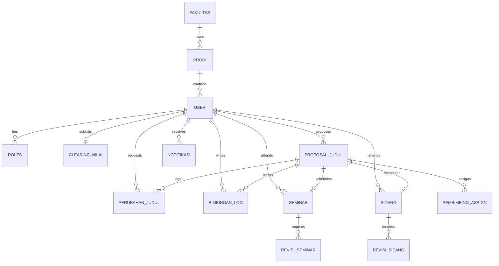

# Database Schema & Data Models — SIMTA-Next

Dokumen ini menjelaskan rancangan basis data, Entity-Relationship Diagram (ERD), serta spesifikasi model **Prisma ORM** yang digunakan pada **SIMTA-Next**.

---

## 1. Entity-Relationship Diagram (ERD)



---

## 2. Definisi Enum State

```prisma
enum RoleEnum {
  MAHASISWA
  DOSEN
  ADMIN_PRODI
  ADMIN_FAKULTAS
  SUPERADMIN
  PIMPINAN
}

enum StatusClearingEnum {
  PENDING
  APPROVED
  REJECTED
}

enum StatusProposalEnum {
  DRAFT
  SUBMITTED
  REVISION_REQUIRED
  APPROVED
  REJECTED
}

enum StatusPerubahanJudulEnum {
  PENDING_PEMBIMBING
  PENDING_PRODI
  APPROVED
  REJECTED
}

enum StatusSeminarEnum {
  PENDING_ACC_DOSEN
  SCHEDULED
  PASSED
  REVISION_REQUIRED
  FAILED
}

enum StatusSidangEnum {
  PENDING_ACC_DOSEN
  ELIGIBILITY_VERIFIED
  SCHEDULED
  PASSED
  REVISION_REQUIRED
  FAILED
}

enum StatusTaEnum {
  CLEARING
  PROPOSAL
  BIMBINGAN
  SEMINAR
  SIDANG
  TAMAT
}
```

---

## 3. Spesifikasi Skema Model Prisma (`schema.prisma`)

```prisma
datasource db {
  provider = "postgresql"
  url      = env("DATABASE_URL")
}

generator client {
  provider = "prisma-client-js"
}

// ------------------------------------------------------
// MASTER DATA & USER MANAGEMENT
// ------------------------------------------------------

model Fakultas {
  id        String   @id @default(uuid())
  kode      String   @unique
  nama      String
  prodiList Prodi[]
  createdAt DateTime @default(now())
  updatedAt DateTime @updatedAt
}

model Prodi {
  id         String   @id @default(uuid())
  kode       String   @unique
  nama       String
  fakultasId String
  fakultas   Fakultas @relation(fields: [fakultasId], references: [id])
  users      User[]
  createdAt  DateTime @default(now())
  updatedAt  DateTime @updatedAt
}

model User {
  id             String        @id @default(uuid())
  nimNip         String        @unique
  nama           String
  email          String        @unique
  noWhatsapp     String?
  passwordHash   String
  role           RoleEnum
  prodiId        String?
  prodi          Prodi?        @relation(fields: [prodiId], references: [id])
  statusTa       StatusTaEnum  @default(CLEARING)
  isVerified     Boolean       @default(false)
  
  // Relations
  clearingNilai  ClearingNilai?
  proposals      ProposalJudul[]    @relation("MahasiswaProposal")
  bimbinganLogs  BimbinganLog[]     @relation("MahasiswaBimbingan")
  feedbackGiven  BimbinganLog[]     @relation("DosenFeedback")
  pembimbingList PembimbingAssign[] @relation("DosenPembimbing")
  pengujiSeminar SeminarPenguji[]
  pengujiSidang  SidangPenguji[]
  notifikasiList Notifikasi[]

  createdAt      DateTime      @default(now())
  updatedAt      DateTime      @updatedAt
}

// ------------------------------------------------------
// CLEARING NILAI & PROPOSAL
// ------------------------------------------------------

model ClearingNilai {
  id             String             @id @default(uuid())
  mahasiswaId    String             @unique
  mahasiswa      User               @relation(fields: [mahasiswaId], references: [id])
  totalSks       Int
  ipk            Float
  fileTranskrip  String
  status         StatusClearingEnum @default(PENDING)
  catatan        String?
  verifiedBy     String?
  verifiedAt     DateTime?
  createdAt      DateTime           @default(now())
  updatedAt      DateTime           @updatedAt
}

model ProposalJudul {
  id             String             @id @default(uuid())
  mahasiswaId    String
  mahasiswa      User               @relation("MahasiswaProposal", fields: [mahasiswaId], references: [id])
  judul          String
  abstrak        String             @db.Text
  bidangKajian   String
  fileDraft      String
  skorKemiripan  Float?
  status         StatusProposalEnum @default(SUBMITTED)
  catatanRevisi  String?
  
  // Relations
  pembimbing     PembimbingAssign[]
  bimbinganLogs  BimbinganLog[]
  perubahanJudul PerubahanJudul[]
  seminar        Seminar?
  sidang         Sidang?

  createdAt      DateTime           @default(now())
  updatedAt      DateTime           @updatedAt
}

model PerubahanJudul {
  id               String                   @id @default(uuid())
  proposalId       String
  proposal         ProposalJudul            @relation(fields: [proposalId], references: [id])
  judulLama        String
  judulBaru        String
  alasanPerubahan  String                   @db.Text
  status           StatusPerubahanJudulEnum @default(PENDING_PEMBIMBING)
  catatanDosen     String?
  catatanProdi     String?
  createdAt        DateTime                 @default(now())
  updatedAt        DateTime                 @updatedAt
}

model PembimbingAssign {
  id           String        @id @default(uuid())
  proposalId   String
  proposal     ProposalJudul @relation(fields: [proposalId], references: [id])
  dosenId      String
  dosen        User          @relation("DosenPembimbing", fields: [dosenId], references: [id])
  posisi       Int           @default(1) // 1 = Pembimbing Utama, 2 = Pembimbing Pendamping
  createdAt    DateTime      @default(now())
}

// ------------------------------------------------------
// LOG BIMBINGAN
// ------------------------------------------------------

model BimbinganLog {
  id             String          @id @default(uuid())
  proposalId     String
  proposal       ProposalJudul   @relation(fields: [proposalId], references: [id])
  mahasiswaId    String
  mahasiswa      User            @relation("MahasiswaBimbingan", fields: [mahasiswaId], references: [id])
  dosenId        String?
  dosen          User?           @relation("DosenFeedback", fields: [dosenId], references: [id])
  catatanUser    String          @db.Text
  catatanFeedback String?        @db.Text
  fileAttachment String?
  isApproved     Boolean         @default(false)
  createdAt      DateTime        @default(now())
  updatedAt      DateTime        @updatedAt
}

// ------------------------------------------------------
// SEMINAR & REVISI
// ------------------------------------------------------

model Seminar {
  id              String            @id @default(uuid())
  proposalId      String            @unique
  proposal        ProposalJudul     @relation(fields: [proposalId], references: [id])
  isAccPembimbing Boolean           @default(false)
  tanggalSeminar  DateTime?
  ruangan         String?
  naskahSeminar   String?
  status          StatusSeminarEnum @default(PENDING_ACC_DOSEN)
  pengujiList     SeminarPenguji[]
  revisi          RevisiSeminar?
  createdAt       DateTime          @default(now())
  updatedAt       DateTime          @updatedAt
}

model SeminarPenguji {
  id        String   @id @default(uuid())
  seminarId String
  seminar   Seminar  @relation(fields: [seminarId], references: [id])
  dosenId   String
  dosen     User     @relation(fields: [dosenId], references: [id])
  nilai     Float?
  catatan   String?
}

model RevisiSeminar {
  id             String   @id @default(uuid())
  seminarId      String   @unique
  seminar        Seminar  @relation(fields: [seminarId], references: [id])
  fileRevisi     String
  buktiPengesahan String?
  isDisetujui    Boolean  @default(false)
  catatanDosen   String?
  createdAt      DateTime @default(now())
  updatedAt      DateTime @updatedAt
}

// ------------------------------------------------------
// SIDANG & REVISI
// ------------------------------------------------------

model Sidang {
  id              String           @id @default(uuid())
  proposalId      String           @unique
  proposal        ProposalJudul    @relation(fields: [proposalId], references: [id])
  isAccPembimbing Boolean          @default(false)
  tanggalSidang   DateTime?
  ruangan         String?
  naskahAkhir     String?
  status          StatusSidangEnum @default(PENDING_ACC_DOSEN)
  pengujiList     SidangPenguji[]
  revisi          RevisiSidang?
  createdAt       DateTime         @default(now())
  updatedAt       DateTime         @updatedAt
}

model SidangPenguji {
  id        String   @id @default(uuid())
  sidangId  String
  sidang    Sidang   @relation(fields: [sidangId], references: [id])
  dosenId   String
  dosen     User     @relation(fields: [dosenId], references: [id])
  nilai     Float?
  catatan   String?
}

model RevisiSidang {
  id             String   @id @default(uuid())
  sidangId       String   @unique
  sidang         Sidang   @relation(fields: [sidangId], references: [id])
  fileNaskahFinal String
  fileBebasRevisi String
  isDisetujui    Boolean  @default(false)
  createdAt      DateTime @default(now())
  updatedAt      DateTime @updatedAt
}

// ------------------------------------------------------
// NOTIFIKASI & AUDIT LOG
// ------------------------------------------------------

model Notifikasi {
  id        String   @id @default(uuid())
  userId    String
  user      User     @relation(fields: [userId], references: [id])
  judul     String
  pesan     String
  isRead    Boolean  @default(false)
  linkUrl   String?
  createdAt DateTime @default(now())
}

model AuditLog {
  id        String   @id @default(uuid())
  userId    String
  action    String
  details   String   @db.Text
  ipAddress String?
  createdAt DateTime @default(now())
}
```
