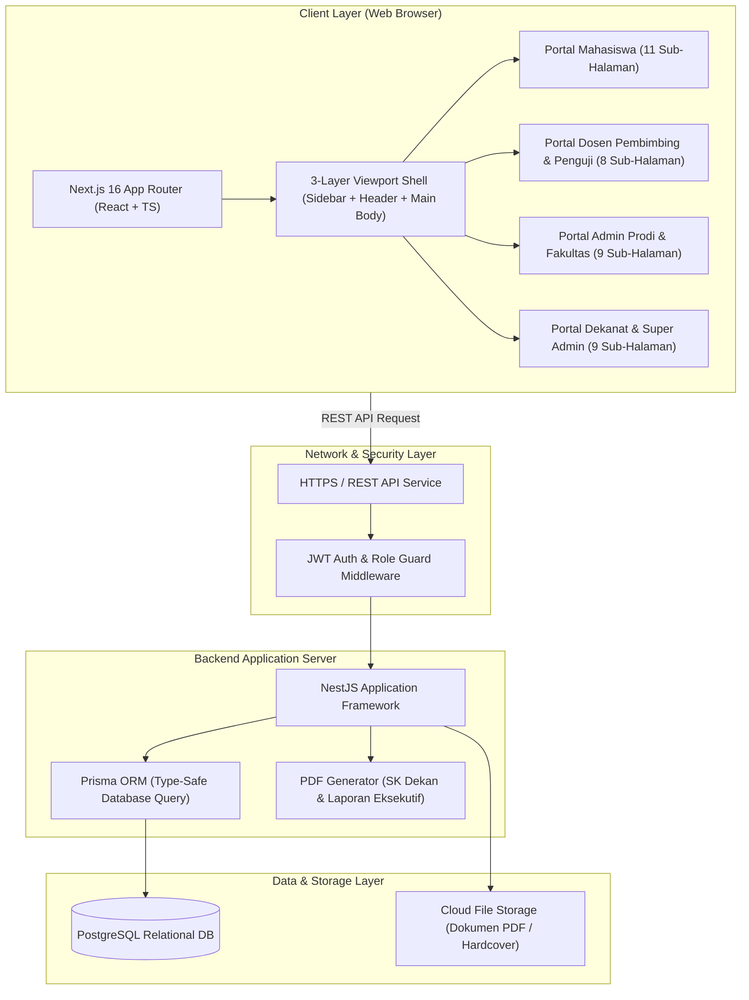
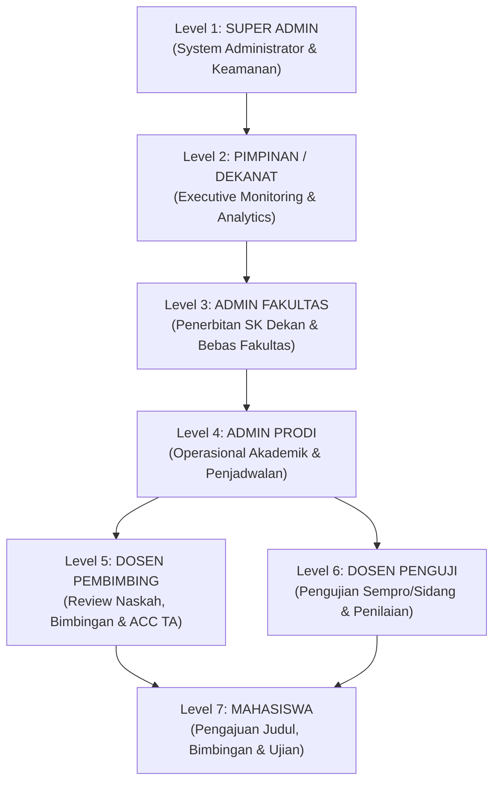
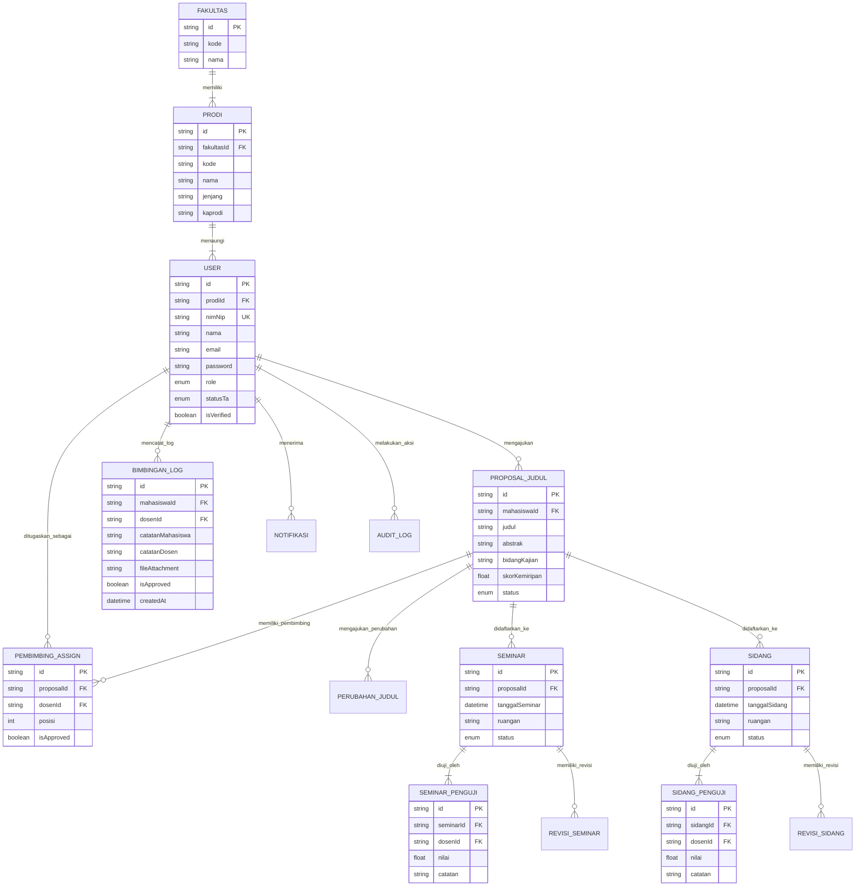

# PRODUCT KNOWLEDGE

# PT MBOIS — Final Project Platform

**Dokumen Pengetahuan Produk (Product Knowledge Document)**

---

| Informasi Dokumen | Keterangan |
|---|---|
| **Nama Produk** | PT MBOIS - Final Project Platform |
| **Instansi** | PT MBOIS |
| **Versi Dokumen** | 1.0 |
| **Tanggal Terbit** | 30 Juli 2026 |
| **Klasifikasi** | Dokumen Resmi — Untuk Diserahkan Kepada Klien |
| **Disusun Oleh** | Tim Pengembang PT MBOIS |

---

## Daftar Isi

1. [Ringkasan Eksekutif](#1-ringkasan-eksekutif)
2. [Latar Belakang & Permasalahan](#2-latar-belakang--permasalahan)
3. [Visi, Misi & Tujuan Platform](#3-visi-misi--tujuan-platform)
4. [Ruang Lingkup Sistem](#4-ruang-lingkup-sistem)
5. [Arsitektur Teknologi](#5-arsitektur-teknologi)
6. [Manajemen Pengguna — 7 Role System](#6-manajemen-pengguna--7-role-system)
7. [Alur Kerja End-to-End Tugas Akhir](#7-alur-kerja-end-to-end-tugas-akhir)
8. [Spesifikasi Modul & Fitur Per Portal](#8-spesifikasi-modul--fitur-per-portal)
9. [Matriks Kewenangan (RBAC)](#9-matriks-kewenangan-rbac)
10. [Desain Antarmuka & Identitas Visual](#10-desain-antarmuka--identitas-visual)
11. [Skema Basis Data](#11-skema-basis-data)
12. [Keamanan & Audit Sistem](#12-keamanan--audit-sistem)
13. [Roadmap Pengembangan](#13-roadmap-pengembangan)
14. [Panduan Penggunaan Ringkas](#14-panduan-penggunaan-ringkas)
15. [Lampiran](#15-lampiran)

---

## 1. Ringkasan Eksekutif

**PT MBOIS - Final Project Platform** adalah platform digital terintegrasi yang dirancang untuk **seluruh Civitas Akademika PT MBOIS** (mencakup seluruh Fakultas dan Program Pascasarjana) guna **memantau, mengelola, dan mengevaluasi seluruh perjalanan Tugas Akhir (TA) dan Skripsi mahasiswa** secara visual, terstruktur, transparan, dan realtime.

Platform ini menghubungkan **7 peran pengguna (role)** dalam satu ekosistem digital terpadu:

| No | Peran Pengguna | Jumlah Modul |
|:---:|---|:---:|
| 1 | Mahasiswa | 11 Modul |
| 2 | Dosen Pembimbing | 4 Modul |
| 3 | Dosen Penguji | 4 Modul |
| 4 | Admin Program Studi (Prodi) | 5 Modul |
| 5 | Admin Fakultas | 4 Modul |
| 6 | Pimpinan / Dekanat | 4 Modul |
| 7 | Super Admin (Administrator Teknis) | 5 Modul |
| | **Total** | **38 Modul** |

Final Project mengotomasi **4 tahapan inti Tugas Akhir**: Usulan Judul & Cek Kemiripan → Bimbingan TA → Seminar Proposal → Ujian Sidang Skripsi, dengan tetap mempertahankan proses clearing nilai sebagai tahapan luring (offline) yang dilakukan langsung di kampus.

---

## 2. Latar Belakang & Permasalahan

### 2.1 Kondisi Eksisting

Pengelolaan Tugas Akhir di lingkungan PT MBOIS selama ini masih mengandalkan proses manual dan semi-digital yang menimbulkan berbagai kendala operasional lintas fakultas:

| No | Permasalahan | Dampak |
|:---:|---|---|
| 1 | Pencatatan log bimbingan menggunakan buku fisik | Rawan hilang, sulit diverifikasi, dan tidak terdokumentasi secara digital |
| 2 | Penjadwalan seminar & sidang via grup WhatsApp | Informasi tidak terpusat, rawan terlewat, dan sulit dilacak riwayatnya |
| 3 | Penerbitan SK Dekan secara manual | Proses lambat, berpotensi kesalahan ketik, dan sulit diarsipkan secara sistematis |
| 4 | Tidak ada dashboard analitik bagi pimpinan | Dekan/Wakil Dekan/Rektorat tidak memiliki visibilitas realtime terhadap progres TA seluruh mahasiswa |
| 5 | Pengecekan duplikasi judul dilakukan secara manual | Memakan waktu lama dan tidak akurat, berpotensi lolos plagiarisme judul |
| 6 | Tidak ada pelacakan status progres TA per mahasiswa | Mahasiswa, dosen, dan admin sulit mengetahui posisi terkini dalam siklus TA |

### 2.2 Kebutuhan Solusi

Dibutuhkan sebuah **platform terpusat berbasis web** yang mampu:

- Memetakan seluruh tahapan Tugas Akhir dalam satu sistem terintegrasi
- Menghubungkan seluruh pemangku kepentingan (mahasiswa, dosen, admin, pimpinan) secara digital
- Menyediakan fitur **cek kemiripan judul (similarity checker)** untuk pencegahan plagiarisme
- Menghasilkan **laporan analitik eksekutif** bagi pimpinan fakultas dan universitas
- Menjaga jejak audit (*audit trail*) untuk akuntabilitas dan transparansi

---

## 3. Visi, Misi & Tujuan Platform

### 3.1 Visi

> Menjadi platform pengelolaan Tugas Akhir terdepan yang memberikan **transparansi, efisiensi, dan akuntabilitas** dalam setiap tahapan perjalanan akademik mahasiswa di seluruh Fakultas PT MBOIS.

### 3.2 Misi

1. **Digitalisasi** seluruh proses perjalanan Tugas Akhir dari pengajuan judul hingga yudisium.
2. **Integrasi** seluruh pemangku kepentingan dalam satu ekosistem platform terpadu.
3. **Transparansi** melalui dashboard realtime, pelacakan status, dan notifikasi otomatis.
4. **Akuntabilitas** melalui jejak audit digital dan pencatatan log aktivitas.
5. **Efisiensi** melalui otomasi proses administratif yang selama ini dikerjakan secara manual.

### 3.3 Tujuan Spesifik

| No | Tujuan | Indikator Keberhasilan |
|:---:|---|---|
| 1 | Mengurangi waktu proses administratif TA | Penurunan waktu proses administrasi sebesar ≥ 40% |
| 2 | Mencegah duplikasi judul skripsi | Skor kemiripan (similarity) < 25% untuk setiap judul baru |
| 3 | Memastikan log bimbingan terdokumentasi digital | 100% sesi bimbingan tercatat dalam sistem |
| 4 | Menyediakan visibilitas progres bagi pimpinan | Dashboard eksekutif dengan data realtime |
| 5 | Mengarsipkan seluruh dokumen TA secara digital | Repositori judul & naskah TA terintegrasi |

---

## 4. Ruang Lingkup Sistem

### 4.1 Dalam Ruang Lingkup (In Scope)

| Aspek | Cakupan |
|---|---|
| **Pengguna** | 7 role: Mahasiswa, Dosen Pembimbing, Dosen Penguji, Admin Prodi, Admin Fakultas, Pimpinan/Dekanat, Super Admin |
| **Modul** | 39 modul halaman lengkap mencakup seluruh siklus TA |
| **Proses Bisnis** | Pengajuan judul, cek kemiripan, pemilihan pembimbing, log bimbingan, penjadwalan seminar/sidang, penilaian, penerbitan SK, verifikasi kelulusan, monitoring eksekutif |
| **Integrasi Offline** | Proses clearing nilai SKS & IPK tetap dilakukan secara luring di kampus |
| **Platform** | Aplikasi berbasis web (responsive desktop & mobile) |

### 4.2 Di Luar Ruang Lingkup (Out of Scope)

| Aspek | Keterangan |
|---|---|
| Proses clearing nilai online | Verifikasi SKS & IPK tetap dilakukan secara manual/luring di kampus |
| Sistem informasi akademik (SIAKAD) | Final Project berdiri sendiri dan tidak menggantikan SIAKAD eksisting |
| Pembayaran SPP & keuangan | Tidak termasuk dalam modul Final Project PT MBOIS |
| E-learning & perkuliahan | Bukan domain Final Project |

---

## 5. Arsitektur Teknologi

### 5.1 Technology Stack

| Layer | Teknologi | Versi | Keterangan |
|---|---|---|---|
| **Frontend Framework** | Next.js (App Router) | 14.x | React Server Components, Client Components, File-based Routing |
| **Bahasa Pemrograman** | TypeScript | 5.x | Strongly-typed, compile-time safety |
| **Styling** | Tailwind CSS | 3.x | Utility-first CSS framework |
| **Icon Library** | Lucide React | Latest | Konsisten, ringan, dan modular |
| **Font System** | Plus Jakarta Sans + IBM Plex Mono | — | Tipografi premium modern |
| **Backend (Planned)** | NestJS | — | Modular Node.js framework + REST API |
| **Database (Planned)** | PostgreSQL + Prisma ORM | — | Relational DB dengan type-safe ORM |
| **Autentikasi (Planned)** | JWT (JSON Web Token) | — | Stateless authentication + RBAC Guard |

### 5.2 Arsitektur Viewport

Final Project mengadopsi **Fit-Viewport Architecture (`100dvh`)** untuk pengalaman pengguna desktop yang premium:

- **Desktop (≥ 1024px):** Halaman fit 1 layar penuh tanpa scroll global. Konten panjang menggunakan scroll internal per-komponen.
- **Tablet (768–1024px):** Sidebar collapsible minimal, grid 2 kolom adaptif.
- **Mobile (< 768px):** Scroll vertikal normal, sidebar overlay drawer, bottom navigation bar.

### 5.3 Diagram Arsitektur Sistem

---

## 6. Manajemen Pengguna — 7 Role System

### 6.1 Diagram Hierarki Peran Pengguna (RBAC)

Final Project menerapkan **Role-Based Access Control (RBAC)** dengan 7 peran pengguna yang disusun berdasarkan hierarki kewenangan:

### 6.2 Profil Detail Setiap Role

#### 6.2.1 Mahasiswa

| Aspek | Deskripsi |
|---|---|
| **Kategori** | Pengguna Akademik (End User Utama) |
| **Prasyarat Akses** | Mahasiswa menyelesaikan clearing nilai SKS & IPK secara **luring di kampus** → Admin Prodi memverifikasi → Akun Final Project diaktifkan |
| **Jumlah Modul** | 11 modul halaman |
| **Fungsi Utama** | Mengusulkan judul TA, cek kemiripan judul, memilih dosen pembimbing, mencatat log bimbingan rutin, mengajukan perubahan judul, memantau jadwal seminar & sidang, mengunggah naskah revisi/final, melihat repositori judul alumni |

**Fitur yang Dapat Diakses:**

1. **Dashboard Utama (`/`)** — Progress stepper 4 tahap TA, status akademik, quick actions
2. **Usulan Judul & Similarity (`/proposal`)** — Form pengajuan judul + simulator cek kemiripan realtime
3. **Pengajuan Dosen Pembimbing (`/pembimbing`)** — Katalog dosen dengan kuota realtime, form pengajuan Pembimbing I & II
4. **Log Bimbingan TA (`/bimbingan`)** — Thread konsultasi, upload draft PDF, minimal 5 sesi terverifikasi
5. **Seminar Proposal (`/seminar`)** — Jadwal sempro, daftar penguji, upload naskah revisi
6. **Ujian Sidang Skripsi (`/sidang`)** — Detail jadwal sidang, majelis penguji, upload hardcover
7. **Repositori Judul (`/list-judul`)** — Pencarian & filter judul TA alumni FIK
8. **Kalender TA (`/kalender`)** — Kalender interaktif bulanan/mingguan/harian
9. **Profil Akademik (`/profil`)** — Banner akademik, statistik, timeline progres
10. **Keamanan Akun (`/akun`)** — Ubah password, status akun
11. **Login (`/login`)** — Form autentikasi kredensial

---

#### 6.2.2 Dosen Pembimbing

| Aspek | Deskripsi |
|---|---|
| **Kategori** | Evaluator & Pembimbing Akademik |
| **Konteks Peran** | Dosen yang ditugaskan sebagai Pembimbing Utama (I) atau Pembimbing Pendamping (II) |
| **Jumlah Modul** | 4 modul halaman |
| **Fungsi Utama** | Mengonfirmasi pengajuan bimbingan, mereview draft naskah, memberikan feedback log bimbingan, approve perubahan judul, memberikan ACC Seminar & Ujian Sidang |

**Fitur yang Dapat Diakses:**

1. **Dashboard Pembimbing (`/dosen/dashboard`)** — Kuota bimbingan, daftar mahasiswa aktif, quick action ACC
2. **Mahasiswa Bimbingan (`/dosen/bimbingan`)** — Card grid mahasiswa, progress bar sesi, action ACC
3. **Permohonan Masuk (`/dosen/pengajuan`)** — Review permohonan pembimbing (IPK/SKS, alasan, terima/tolak)
4. **Jadwal & Sidang (`/dosen/kalender`)** — Timeline agenda bimbingan & jadwal sidang

---

#### 6.2.3 Dosen Penguji

| Aspek | Deskripsi |
|---|---|
| **Kategori** | Evaluator Ujian Akademik |
| **Konteks Peran** | Dosen yang ditunjuk dalam Tim Majelis Penguji Seminar Proposal atau Ujian Sidang Skripsi |
| **Jumlah Modul** | 4 modul halaman |
| **Fungsi Utama** | Menguji pelaksanaan ujian, menginput nilai komprehensif, memberikan catatan revisi, memverifikasi kelayakan perbaikan naskah |

**Fitur yang Dapat Diakses:**

1. **Dashboard Penguji (`/penguji/dashboard`)** — Stats grid 4 metrik, tabel pengujian, input nilai cepat
2. **Jadwal Pengujian (`/penguji/jadwal`)** — Tabel sempro/sidang, blok tanggal visual, search & filter
3. **Input Nilai (`/penguji/nilai`)** — Form skor per komponen, range slider, weighted auto score
4. **Lembar Revisi (`/penguji/revisi`)** — Catatan revisi, review upload mahasiswa, ACC revisi

---

#### 6.2.4 Admin Program Studi (Prodi) FIK

| Aspek | Deskripsi |
|---|---|
| **Kategori** | Pengelola Operasional Akademik |
| **Konteks Peran** | Staf administrasi akademik di tingkat Program Studi (Teknik Informatika, Sistem Informasi, dll.) |
| **Jumlah Modul** | 5 modul halaman |
| **Fungsi Utama** | Mengaktifkan akun mahasiswa pasca clearing luring, memvalidasi pengajuan pembimbing, menjadwalkan seminar & sidang, menetapkan majelis penguji, mengelola repositori judul |

**Fitur yang Dapat Diakses:**

1. **Dashboard Prodi (`/admin-prodi/dashboard`)** — Stats operasional, tabel mahasiswa TA, panel aktivasi cepat
2. **Manajemen Mahasiswa (`/admin-prodi/mahasiswa`)** — Tabel master data, filter tahap TA, side panel detail
3. **Aktivasi Akun (`/admin-prodi/aktivasi`)** — Antrean clearing luring, trigger pembuatan kredensial
4. **Kelola Jadwal (`/admin-prodi/jadwal`)** — Penjadwalan sempro/sidang, penetapan majelis penguji & ruangan
5. **Repositori Judul (`/admin-prodi/repositori`)** — Database judul TA yang disetujui, filter bidang kajian

---

#### 6.2.5 Admin Fakultas

| Aspek | Deskripsi |
|---|---|
| **Kategori** | Administrator Administrasi Fakultas |
| **Konteks Peran** | Staf Tata Usaha di tingkat Fakultas Ilmu Komputer PT MBOIS |
| **Jumlah Modul** | 4 modul halaman |
| **Fungsi Utama** | Menerbitkan SK Dekan penetapan pembimbing/penguji, memverifikasi bebas fakultas (pustaka, lab, SPP), mengarsipkan dokumen resmi TA |

**Fitur yang Dapat Diakses:**

1. **Dashboard Fakultas (`/admin-fakultas/dashboard`)** — Statistik SK & bebas fakultas, tabel SK Dekan, quick action
2. **Penerbitan SK Dekan (`/admin-fakultas/sk`)** — Generate & download SK Dekan format PDF
3. **Bebas Fakultas (`/admin-fakultas/bebas`)** — Verifikasi bebas pustaka, bebas lab, & bebas SPP
4. **Arsip Dokumen (`/admin-fakultas/arsip`)** — Repositori digital SK Dekan, yudisium, & pedoman TA

---

#### 6.2.6 Pimpinan / Dekanat

| Aspek | Deskripsi |
|---|---|
| **Kategori** | Executive Monitoring & Decision Making |
| **Konteks Peran** | Dekan, Wakil Dekan, dan Ketua Lembaga Penjaminan Mutu FIK PT MBOIS |
| **Jumlah Modul** | 4 modul halaman |
| **Fungsi Utama** | Memantau indikator kinerja utama TA secara read-only, menganalisis tren riset, mengevaluasi durasi masa studi, mengunduh laporan eksekutif |

**Fitur yang Dapat Diakses:**

1. **Dashboard Eksekutif (`/dekanat/dashboard`)** — SVG donut chart distribusi bidang, stats trend, rekap angkatan
2. **Statistik TA & Analitik (`/dekanat/statistik`)** — IPK kelulusan, ketepatan waktu studi, publikasi jurnal
3. **Kalender Sidang (`/dekanat/kalender`)** — Agenda seminar & sidang read-only
4. **Laporan Eksekutif (`/dekanat/laporan`)** — Pusat unduh dokumen rekapitulasi PDF

---

#### 6.2.7 Super Admin (Administrator Teknis)

| Aspek | Deskripsi |
|---|---|
| **Kategori** | Technical System Administrator |
| **Konteks Peran** | Tim IT pengelola infrastruktur dan keamanan sistem informasi |
| **Jumlah Modul** | 5 modul halaman |
| **Fungsi Utama** | Mengelola akun pengguna, mengonfigurasi parameter sistem, memantau audit log, mengelola master data referensi |

**Fitur yang Dapat Diakses:**

1. **Dashboard Teknis (`/super-admin/dashboard`)** — Statistik user & log, quick access user & config
2. **Manajemen User (`/super-admin/users`)** — Tabel akun, edit role, status akses, reset password
3. **Audit Log (`/super-admin/audit`)** — Log aktivitas realtime, IP address, event types
4. **Konfigurasi Sistem (`/super-admin/config`)** — Toggle maintenance mode, kuota bimbingan, batas similarity
5. **Master Data (`/super-admin/master`)** — Pengelolaan data referensi prodi, jenjang, & ketua prodi

---

## 7. Alur Kerja End-to-End Tugas Akhir

### 7.1 Diagram Alur Kerja End-to-End Tugas Akhir

Seluruh perjalanan Tugas Akhir mahasiswa di Final Project melewati **5 tahapan besar** yang saling terhubung:

```mermaid
flowchart TD
    subgraph S0["STAGE 0: Clearing Nilai Luring (Kampus Offline)"]
        A1["Mahasiswa Mengurus Clearing SKS & IPK di Kampus"] --> A2["Admin Prodi Verifikasi Syarat 110 SKS & IPK ≥ 2.00"]
        A2 --> A3["Admin Prodi Aktifkan Akun Final Project Mahasiswa"]
    end

    subgraph S1["STAGE 1: Usulan Judul & Cek Kemiripan (Online)"]
        A3 --> B1["Mahasiswa Input Form Proposal & Abstrak Judul"]
        B1 --> B2["System Run Similarity Checker Simulator"]
        B2 -->|Similarity < 25%| B3["Judul Approved & Masuk Repositori"]
        B2 -->|Similarity ≥ 25%| B1
    end

    subgraph S2["STAGE 2: Pembimbingan & Sesi Rutin (Online)"]
        B3 --> C1["Mahasiswa Ajukan Dosen Pembimbing I & II"]
        C1 --> C2["Admin Prodi & Dosen Konfirmasi Pembimbing"]
        C2 --> C3["Sesi Bimbingan Rutin (Upload PDF & Thread Log)"]
        C3 -->|Minimal 5 Sesi Terverifikasi| C4["Dosen Pembimbing Klik Tombol ACC Seminar"]
    end

    subgraph S3["STAGE 3: Seminar Proposal (Online)"]
        C4 --> D1["Admin Prodi Penjadwalan Sempro & Plotting Tim Penguji"]
        D1 --> D2["Pelaksanaan Seminar Proposal & Input Nilai Penguji"]
        D2 --> D3["Mahasiswa Upload Revisi Sempro → Approval Penguji"]
    end

    subgraph S4["STAGE 4: Ujian Sidang Skripsi & Yudisium (Online)"]
        D3 --> E1["Dosen Pembimbing Klik Tombol ACC Ujian Sidang"]
        E1 --> E2["Admin Prodi Penjadwalan Ujian Sidang Skripsi"]
        E2 --> E3["Pelaksanaan Sidang Skripsi & Input Nilai Komprehensif"]
        E3 --> E4["Mahasiswa Upload Naskah Hardcover Final"]
        E4 --> E5["Admin Fakultas Verifikasi Bebas Fakultas (Lab, Pustaka, SPP)"]
        E5 --> E6["Penerbitan SK Dekan & Pengesahan Kelulusan Yudisium"]
    end
```

### 7.2 Detail Alur Per Tahap

#### Stage 0 — Prasyarat: Clearing Nilai (Proses Luring / Offline di Kampus)

| Langkah | Pelaku | Aksi | Lokasi |
|:---:|---|---|---|
| 1 | Mahasiswa | Datang ke kampus dengan membawa transkrip nilai | Bagian Akademik FIK |
| 2 | Admin Prodi | Memverifikasi kelengkapan SKS (≥ 144) dan IPK | Kantor Admin Prodi |
| 3 | Admin Prodi | Mengaktifkan akun Final Project mahasiswa (`/admin-prodi/aktivasi`) | Sistem Final Project |

> **Catatan Penting:** Proses clearing nilai **TIDAK** dilakukan di dalam aplikasi Final Project PT MBOIS. Ini merupakan proses manual yang harus diselesaikan langsung di kampus. Setelah clearing selesai, Admin Prodi akan membuat dan mengaktifkan akun Final Project mahasiswa.

---

#### Stage 1 — Pengajuan Judul, Cek Kemiripan & Pemilihan Dosen Pembimbing

| Langkah | Pelaku | Aksi | Modul Final Project |
|:---:|---|---|---|
| 1 | Mahasiswa | Login ke Final Project dan mengisi form usulan judul (judul, abstrak, bidang kajian) | `/proposal` |
| 2 | Mahasiswa | Menjalankan **Simulator Cek Kemiripan (Similarity)** realtime | `/proposal` |
| 3 | Sistem | Menghitung skor kemiripan dengan judul-judul terdaftar (< 25% = Layak) | Otomatis |
| 4 | Mahasiswa | Mencari dan memilih calon Dosen Pembimbing I & II dari katalog dosen | `/pembimbing` |
| 5 | Mahasiswa | Mengirim permohonan bimbingan beserta alasan pemilihan | `/pembimbing` |
| 6 | Dosen Pembimbing | Menerima notifikasi dan mereview permohonan mahasiswa | `/dosen/pengajuan` |
| 7 | Dosen Pembimbing | Menerima atau menolak permohonan bimbingan | `/dosen/pengajuan` |
| 8 | Admin Prodi | Memvalidasi dan mengonfirmasi penetapan pembimbing tingkat prodi | `/admin-prodi/mahasiswa` |

---

#### Stage 2 — Bimbingan TA (Minimal 5 Sesi Terverifikasi)

| Langkah | Pelaku | Aksi | Modul Final Project |
|:---:|---|---|---|
| 1 | Mahasiswa | Mengunggah draft naskah PDF dan mencatat log sesi bimbingan | `/bimbingan` |
| 2 | Dosen Pembimbing | Mereview draft, memberikan feedback via thread catatan | `/dosen/bimbingan` |
| 3 | Dosen Pembimbing | Mengesahkan (approve) log bimbingan yang valid | `/dosen/bimbingan` |
| 4 | *Ulangi langkah 1–3 minimal 5 kali* | — | — |
| 5 | Mahasiswa (Opsional) | Mengajukan perubahan judul jika ada revisi arah penelitian besar | `/bimbingan` |
| 6 | Dosen Pembimbing (Opsional) | Mereview dan approve/reject perubahan judul | `/dosen/bimbingan` |
| 7 | Admin Prodi (Opsional) | Memberikan konfirmasi final perubahan judul tingkat prodi | `/admin-prodi/mahasiswa` |

---

#### Stage 3 — ACC & Pelaksanaan Seminar Proposal

| Langkah | Pelaku | Aksi | Modul Final Project |
|:---:|---|---|---|
| 1 | Mahasiswa | Mengajukan permintaan ACC Seminar Proposal | `/seminar` |
| 2 | Dosen Pembimbing | Memverifikasi kelengkapan bimbingan (≥ 5 sesi) dan klik **ACC Seminar** | `/dosen/bimbingan` |
| 3 | Admin Prodi | Menjadwalkan tanggal, waktu, ruangan, dan menetapkan Dosen Penguji | `/admin-prodi/jadwal` |
| 4 | Admin Fakultas | Menerbitkan **SK Dekan** penetapan Majelis Penguji | `/admin-fakultas/sk` |
| 5 | Dosen Penguji | Melaksanakan pengujian dan menginput nilai seminar | `/penguji/nilai` |
| 6 | Dosen Penguji | Memberikan catatan revisi/perbaikan | `/penguji/revisi` |
| 7 | Mahasiswa | Mengunggah naskah perbaikan pasca seminar | `/seminar` |
| 8 | Dosen Pembimbing | Meng-approve lembar pengesahan revisi sempro | `/dosen/bimbingan` |

---

#### Stage 4 — ACC & Pelaksanaan Ujian Sidang Skripsi Final

| Langkah | Pelaku | Aksi | Modul Final Project |
|:---:|---|---|---|
| 1 | Dosen Pembimbing | Memberikan **ACC Ujian Sidang Skripsi** | `/dosen/bimbingan` |
| 2 | Admin Prodi | Menjadwalkan ujian sidang di Aula FIK dan menetapkan Dewan Penguji | `/admin-prodi/jadwal` |
| 3 | Admin Fakultas | Menerbitkan SK Dekan penetapan Dewan Penguji sidang | `/admin-fakultas/sk` |
| 4 | Dosen Penguji | Melaksanakan pengujian komprehensif dan menginput nilai sidang | `/penguji/nilai` |
| 5 | Mahasiswa | Mengunggah naskah final hardcover & bukti bebas revisi | `/sidang` |
| 6 | Dosen Pembimbing | Meng-approve bebas revisi pembimbing & penguji | `/dosen/bimbingan` |
| 7 | Admin Fakultas | Memverifikasi Bebas Pustaka, Bebas Lab, & Bebas SPP | `/admin-fakultas/bebas` |
| 8 | Admin Fakultas | Mengarsipkan naskah final ke repositori digital | `/admin-fakultas/arsip` |
| 9 | Pimpinan/Dekanat | Memantau rekapitulasi kelulusan di dashboard eksekutif | `/dekanat/dashboard` |

---

### 7.3 Peta Interkoneksi Antar Role

Berikut adalah ringkasan hubungan dan pertukaran data antar 7 role dalam Final Project:

| Koneksi | Penjelasan Interaksi | Data yang Dipertukarkan |
|---|---|---|
| **Mahasiswa ↔ Admin Prodi** | Admin Prodi mengaktifkan akun mahasiswa pasca clearing luring | NIM, IPK, SKS, Status Akun |
| **Mahasiswa ↔ Dosen Pembimbing** | Mahasiswa berkonsultasi via thread bimbingan; Dosen memberikan ACC | Draft PDF, Log Bimbingan, Status ACC |
| **Admin Prodi ↔ Admin Fakultas** | Admin Prodi jadwalkan sidang → Admin Fakultas terbitkan SK Dekan | No. SK, Jadwal, Nama Dosen |
| **Admin Prodi ↔ Dosen Penguji** | Admin Prodi menugaskan penguji → Penguji input nilai | Penetapan Majelis, Skor Komponen |
| **Dosen Penguji ↔ Mahasiswa** | Penguji memberikan revisi → Mahasiswa upload perbaikan | Catatan Revisi, Naskah Perbaikan |
| **Admin Fakultas ↔ Mahasiswa** | Admin Fakultas verifikasi bebas fakultas untuk kelulusan | SKBF, File Hardcover |
| **Pimpinan ← Seluruh Role** | Menerima aggregated data feed untuk analitik eksekutif | Grafik, Statistik, Laporan PDF |
| **Super Admin → Seluruh Role** | Mengelola akses, konfigurasi, dan audit log sistem | Akun User, Parameter, Log Aktivitas |

---

## 8. Spesifikasi Modul & Fitur Per Portal

### 8.1 Portal Mahasiswa — 11 Modul

| No | Rute | Nama Modul | Fitur Utama |
|:---:|---|---|---|
| 1 | `/` | Dashboard Utama | Stepper progres 4 tahap TA, banner status akademik (NIM, SKS, IPK), quick action buttons, checklist syarat ACC |
| 2 | `/proposal` | Usulan Judul & Similarity | Form pengajuan judul (judul, abstrak, bidang kajian RPL/AI/Jaringan), simulator cek kemiripan realtime dengan indikator skor persentase |
| 3 | `/pembimbing` | Pengajuan Dosen Pembimbing | Katalog dosen FIK dengan NIDN, jabatan fungsional, bidang keahlian, kuota bimbingan realtime. Form pengajuan Pembimbing I & II |
| 4 | `/bimbingan` | Log Bimbingan TA | Thread chat-style bimbingan, modal catat log baru + upload draft PDF, modal pengajuan perubahan judul, progress sesi (min. 5x) |
| 5 | `/seminar` | Seminar Proposal | Jadwal seminar proposal, lokasi ruangan, daftar penguji, form upload naskah revisi pasca seminar |
| 6 | `/sidang` | Ujian Sidang Skripsi | Jadwal ujian sidang di Aula FIK, majelis dewan penguji, form upload naskah final hardcover & lembar bebas revisi |
| 7 | `/list-judul` | Repositori Judul TA | Pencarian & filter judul TA alumni FIK (search by nama/NIM/judul/dosen), filter bidang kajian, widget distribusi domain penelitian |
| 8 | `/kalender` | Kalender TA Interaktif | Grid kalender bulanan 35 cell, switch mode bulan/minggu/hari, chip event berwarna (bimbingan/sempro/sidang/deadline), detail agenda modal |
| 9 | `/profil` | Profil Akademik | Banner data akademik, stats grid prestasi, timeline progres TA |
| 10 | `/akun` | Keamanan Akun | Ubah password, status keamanan akun |
| 11 | `/login` | Login | Form kredensial (NIM/NIDN/Username + Password) |

---

### 8.2 Portal Dosen Pembimbing — 4 Modul

| No | Rute | Nama Modul | Fitur Utama |
|:---:|---|---|---|
| 1 | `/dosen/dashboard` | Dashboard Pembimbing | Kuota bimbingan aktif, daftar mahasiswa bimbingan, quick action ACC Seminar/Sidang, panel permohonan masuk terbaru |
| 2 | `/dosen/bimbingan` | Mahasiswa Bimbingan | Card grid seluruh mahasiswa bimbingan, progress bar sesi per mahasiswa, action button ACC Seminar & ACC Sidang |
| 3 | `/dosen/pengajuan` | Permohonan Masuk | Daftar permohonan pembimbing dari mahasiswa baru, detail IPK/SKS, toggle alasan pemilihan, tombol Terima/Tolak |
| 4 | `/dosen/kalender` | Jadwal & Sidang | Timeline blok tanggal agenda bimbingan & jadwal sidang, label jenis kegiatan, tombol kehadiran |

---

### 8.3 Portal Dosen Penguji — 4 Modul

| No | Rute | Nama Modul | Fitur Utama |
|:---:|---|---|---|
| 1 | `/penguji/dashboard` | Dashboard Penguji | Stats grid 4 metrik pengujian, tabel jadwal pengujian terintegrasi, input nilai cepat |
| 2 | `/penguji/jadwal` | Jadwal Pengujian | Tabel sempro & sidang yang ditugaskan, blok tanggal visual, search & filter |
| 3 | `/penguji/nilai` | Input Nilai | Form skor per komponen ujian, range slider interaktif, weighted auto score (kalkulasi otomatis) |
| 4 | `/penguji/revisi` | Lembar Revisi | Catatan revisi per mahasiswa, review upload naskah perbaikan, tombol ACC revisi |

---

### 8.4 Portal Admin Program Studi (Admin Prodi) — 6 Modul

| No | Rute | Nama Modul | Fitur Utama |
|:---:|---|---|---|
| 1 | `/admin-prodi/dashboard` | Dashboard Prodi | Stats grid operasional, tabel mahasiswa TA aktif, panel aktivasi cepat |
| 2 | `/admin-prodi/mahasiswa` | Manajemen Mahasiswa | Tabel master data mahasiswa TA, filter berdasarkan tahap, side panel detail per mahasiswa |
| 3 | `/admin-prodi/aktivasi` | Aktivasi Akun | Antrean mahasiswa yang telah clearing luring, trigger pembuatan kredensial login |
| 4 | `/admin-prodi/jadwal` | Kelola Jadwal | Penjadwalan seminar proposal & ujian sidang, penetapan majelis penguji, pemilihan ruangan |
| 5 | `/admin-prodi/repositori` | Repositori Judul | Database judul TA yang telah disetujui, filter berdasarkan bidang kajian |

---

### 8.5 Portal Admin Fakultas — 4 Modul

| No | Rute | Nama Modul | Fitur Utama |
|:---:|---|---|---|
| 1 | `/admin-fakultas/dashboard` | Dashboard Fakultas | Statistik penerbitan SK & bebas fakultas, tabel SK Dekan terbaru, quick action |
| 2 | `/admin-fakultas/sk` | Penerbitan SK Dekan | Tabel SK penetapan pembimbing & penguji, generate SK format PDF, download & cetak |
| 3 | `/admin-fakultas/bebas` | Bebas Fakultas | Verifikasi bebas pustaka, bebas laboratorium, & bebas SPP per mahasiswa |
| 4 | `/admin-fakultas/arsip` | Arsip Dokumen | Repositori digital SK Dekan, dokumen yudisium, dan pedoman TA |

---

### 8.6 Portal Pimpinan / Dekanat — 4 Modul

| No | Rute | Nama Modul | Fitur Utama |
|:---:|---|---|---|
| 1 | `/dekanat/dashboard` | Dashboard Eksekutif | SVG donut chart distribusi bidang kajian (RPL, AI, Jaringan), stats trend semester, rekap per angkatan |
| 2 | `/dekanat/statistik` | Statistik TA & Analitik | Rata-rata IPK kelulusan, persentase ketepatan waktu studi, jumlah publikasi jurnal |
| 3 | `/dekanat/kalender` | Kalender Sidang Executive | Agenda seminar & sidang skripsi (read-only), filter per prodi |
| 4 | `/dekanat/laporan` | Laporan Eksekutif | Pusat unduh dokumen rekapitulasi kelulusan PDF, laporan per semester/angkatan |

---

### 8.7 Portal Super Admin — 5 Modul

| No | Rute | Nama Modul | Fitur Utama |
|:---:|---|---|---|
| 1 | `/super-admin/dashboard` | Dashboard Teknis | Statistik total user & log aktivitas, quick access manajemen user & konfigurasi |
| 2 | `/super-admin/users` | Manajemen User | Tabel seluruh akun pengguna, edit role, toggle status akses, reset password |
| 3 | `/super-admin/audit` | Audit Log | Log aktivitas realtime, pelacakan IP address, filter berdasarkan event type |
| 4 | `/super-admin/config` | Konfigurasi Sistem | Toggle mode maintenance, pengaturan kuota bimbingan dosen, batas skor similarity |
| 5 | `/super-admin/master` | Master Data | Pengelolaan data referensi: program studi, jenjang pendidikan, ketua prodi |

---

## 9. Matriks Kewenangan (RBAC)

Tabel berikut merangkum hak akses setiap role terhadap fitur-fitur utama sistem:

| Fitur / Aksi | Mahasiswa | Dosen Pembimbing | Dosen Penguji | Admin Prodi | Admin Fakultas | Pimpinan | Super Admin |
|---|:---:|:---:|:---:|:---:|:---:|:---:|:---:|
| **Clearing Nilai** | Urus Luring | — | — | Aktivasi Akun | — | — | Full |
| **Usulan Judul & Similarity** | Submit & Cek | — | — | Review & Approve | Read | Read | Full |
| **Pengajuan Pembimbing** | Select & Submit | Confirm | — | Assign & Verify | Terbitkan SK | Read | Full |
| **Log Bimbingan TA** | Create & Write | Feedback & Approve | — | Read | Read | Read | Full |
| **Perubahan Judul** | Submit | Review & Approve | — | Final Approval | Read | Read | Full |
| **Penjadwalan Sempro/Sidang** | View Kalender | View Kalender | View Kalender | Create & Schedule | View Kalender | Read | Full |
| **Penilaian Ujian** | View Nilai | — | Input Nilai | View Nilai | View Nilai | Read | Full |
| **SK Dekan & Bebas Fakultas** | View | — | — | Request | Create & Publish | Read | Full |
| **Executive Reports** | — | — | — | Read | Read | Full Analytics | Full |
| **Audit Log & Config** | — | — | — | — | — | — | Full |

**Keterangan:**
- **Full** = Akses penuh (Create, Read, Update, Delete)
- **Read** = Hanya dapat melihat data
- **—** = Tidak memiliki akses

---

## 10. Desain Antarmuka & Identitas Visual

### 10.1 Identitas Brand

Final Project memadukan identitas resmi **PT MBOIS** dengan estetika antarmuka modern berkelas tinggi:

| Elemen | Spesifikasi |
|---|---|
| **Warna Utama (Primary)** | Deep Crimson Red `#2563eb` — Warna khas PT MBOIS |
| **Warna Aksen (Accent)** | Amber Gold `#38bdf8` — Aksen akademik premium |
| **Warna Sukses (Success)** | Emerald Green `#2F8F5B` — Status disetujui/lulus |
| **Background Utama** | Clean Slate `#FAFAFA` — Latar bersih dan profesional |
| **Surface Card** | Pure White `#FFFFFF` — Kartu konten bersih |
| **Dark Hero** | Charcoal `#1A1A1A` — Sidebar, welcome banner, hero section |
| **Tipografi Display** | Plus Jakarta Sans (Bold/Black) — Modern dan profesional |
| **Tipografi Data** | IBM Plex Mono — NIM, kode dokumen, skor numerik |

### 10.2 Komponen Antarmuka Utama

#### Sidebar Navigasi

- Latar belakang gelap (`#1A1A1A`) dengan logo emblem **PT MBOIS** di bagian atas
- Menu aktif menggunakan pill gradient merah khas (`#2563eb` → `#1d4ed8`)
- Animasi collapse/expand 300ms untuk pengalaman responsif

#### Header Bar

### 10.2 Komponen Desain Utama

#### Header & Top Navigation

- Layout fit-viewport 100% atau natural page scroll yang responsif
- Tombol toggle sidebar di pojok kiri
- Garis aksen warna merah-emas di bagian atas (`#2563eb` via `#38bdf8`)
- Indikator profil pengguna dengan nama, NIK/NIM, dan prodi

#### Welcome Banner

- Banner gelap (`#1A1A1A`) dengan border neutral di setiap halaman portal
- Garis aksen gradient merah-emas di bagian bawah banner
- Badge warna sesuai role pengguna dengan Red Signature (`#2563eb`)

#### Pola Tabel List Ringkas + Live Side Detail Panel Card

- Seluruh tabel utama menghilangkan kolom `AKSI` redundan demi efisiensi ruang
- Dikombinasikan dengan kartu panel detail di kolom kanan (`w-80 shrink-0`) yang ter-update secara *live* saat pengguna mengklik baris mana saja pada tabel list
- Baris terdefinisi dengan indikator highlight `bg-blue-50/70 border-l-4 border-l-[#2563eb]`

#### Kartu Statistik Seragam

- Seluruh kartu statistik status/antrean di dashboard 7 role menggunakan aksen warna **Kuning Emas Amber Warm (`#D97706` / `bg-amber-500`)**
- Tidak menggunakan warna ungu (`#7C3AED`) pada chart maupun indikator progres (menggunakan Teal `#0D9488`)

#### Skeleton Loading UI System (`loading.tsx`)

- Terpasang pada seluruh 7 role portal di aplikasi Final Project PT MBOIS via file `loading.tsx` App Router dan komponen `PageSkeleton`
- Menggunakan animasi denyut halus (`animate-pulse bg-slate-200`) yang menyerupai arsitektur 3-layer flex Final Project untuk impresi respon instan

#### Empty State UI System

- Ditampilkan otomatis apabila kontainer tabel atau thread bimbingan masih dalam kondisi kosong (0 data)
- Dilengkapi dengan ikon kontekstual ber-border soft blue, judul status kosong, teks penjelas penyebab, dan tombol tindakan cepat (*call-to-action*)

### 10.3 Warna Akses & Palette Sistem

| Elemen UI | Warna Utama | Kode Warna Tailwind |
|---|---|---|
| Red Signature (Tombol & Banner) | Royal Blue Signature PT MBOIS | `bg-[#2563eb]` / `#2563eb` |
| Kartu Statistik Antrean | Kuning Emas Amber Warm | `bg-amber-500` / `#D97706` |
| Indikator Seminar Proposal | Teal Modern | `bg-teal-600` / `#0D9488` |
| Teks Highlight & Status Lulus | Emerald | `bg-emerald-600` / `#059669` |
| Slate & Neutral Background | Neutral Slate | `bg-[#f8fafc]` / `bg-slate-900` |

### 10.4 Responsivitas Multi-Device

| Breakpoint | Lebar Layar | Perilaku Antarmuka |
|---|---|---|
| **Desktop** | ≥ 1024px | Layout penuh, sidebar expanded 260px, grid 4 kolom |
| **Tablet** | 768–1024px | Sidebar collapsible minimal, grid 2 kolom |
| **Mobile** | < 768px | Sidebar overlay drawer, scroll vertikal, bottom navigation bar |

---

## 11. Skema Basis Data

### 11.1 Ringkasan Entitas

Final Project menggunakan **15 tabel utama** dan **6 enum state** dalam skema basis data PostgreSQL:

| Kategori | Tabel | Keterangan |
|---|---|---|
| **Master Data** | `Fakultas`, `Prodi`, `User` | Data referensi organisasi dan akun pengguna |
| **Proposal & Pembimbing** | `ProposalJudul`, `PembimbingAssign`, `PerubahanJudul` | Pengajuan judul, penetapan pembimbing, dan perubahan judul |
| **Bimbingan** | `BimbinganLog` | Catatan sesi bimbingan rutin mahasiswa-dosen |
| **Seminar** | `Seminar`, `SeminarPenguji`, `RevisiSeminar` | Jadwal seminar proposal, majelis penguji, dan revisi |
| **Sidang** | `Sidang`, `SidangPenguji`, `RevisiSidang` | Jadwal ujian sidang, majelis penguji, dan revisi |
| **Sistem** | `Notifikasi`, `AuditLog` | Notifikasi pengguna dan jejak audit aktivitas |

### 11.2 Enum State Machine

| Enum | Nilai | Keterangan |
|---|---|---|
| `RoleEnum` | MAHASISWA, DOSEN, ADMIN_PRODI, ADMIN_FAKULTAS, PIMPINAN, SUPERADMIN | 6 role di level database (Dosen Pembimbing & Penguji di-handle di level aplikasi) |
| `StatusProposalEnum` | DRAFT → SUBMITTED → REVISION_REQUIRED → APPROVED / REJECTED | Siklus hidup proposal judul |
| `StatusPerubahanJudulEnum` | PENDING_PEMBIMBING → PENDING_PRODI → APPROVED / REJECTED | Alur approval perubahan judul 2 tingkat |
| `StatusSeminarEnum` | PENDING_ACC_DOSEN → SCHEDULED → PASSED / REVISION_REQUIRED / FAILED | Status pelaksanaan seminar proposal |
| `StatusSidangEnum` | PENDING_ACC_DOSEN → ELIGIBILITY_VERIFIED → SCHEDULED → PASSED / REVISION_REQUIRED / FAILED | Status pelaksanaan ujian sidang |
| `StatusTaEnum` | PROPOSAL → BIMBINGAN → SEMINAR → SIDANG | 4 tahap progres TA aktif |

### 11.3 Entity-Relationship Diagram (ERD)

---

## 12. Keamanan & Audit Sistem

### 12.1 Autentikasi & Otorisasi

| Aspek | Implementasi |
|---|---|
| **Metode Autentikasi** | JWT (JSON Web Token) — Stateless authentication |
| **Penyimpanan Password** | Hash menggunakan algoritma bcrypt dengan salt |
| **Manajemen Sesi** | Token-based session dengan expiry time |
| **Otorisasi** | Role-Based Access Control (RBAC) dengan 7 level role |
| **Route Guard** | Setiap endpoint API dilindungi oleh middleware RBAC guard |

### 12.2 Audit Log

Seluruh aktivitas penting dalam sistem dicatat dalam tabel `AuditLog` yang mencakup:

| Field | Keterangan |
|---|---|
| `userId` | Identitas pengguna yang melakukan aksi |
| `action` | Jenis aksi yang dilakukan (LOGIN, CREATE, UPDATE, DELETE, dll.) |
| `details` | Deskripsi detail aktivitas |
| `ipAddress` | Alamat IP pengguna |
| `createdAt` | Timestamp aksi dilakukan |

### 12.3 Fitur Keamanan Tambahan

- **Mode Maintenance:** Super Admin dapat mengaktifkan mode maintenance untuk mencegah akses pengguna saat pemeliharaan sistem.
- **Reset Password:** Super Admin dapat melakukan reset password pengguna yang lupa kredensial.
- **IP Tracking:** Pelacakan alamat IP pada setiap aktivitas login dan aksi kritis.
- **Threshold Similarity:** Konfigurasi batas skor kemiripan judul (default: 25%) yang dapat disesuaikan oleh Super Admin.

---

## 13. Roadmap Pengembangan

### 13.1 Status Pengembangan Saat Ini

| Fase | Status | Keterangan |
|---|:---:|---|
| **Fase 1A — Fondasi & Design System** | ✅ Selesai | Arsitektur viewport, tokens warna, tipografi, komponen layout |
| **Fase 1B — Portal Mahasiswa (11 Modul)** | ✅ Selesai | Seluruh 11 sub-halaman mahasiswa |
| **Fase 1C — Portal 6 Role Tambahan (26 Modul)** | ✅ Selesai | Dosen Pembimbing (4), Dosen Penguji (4), Admin Prodi (5), Admin Fakultas (4), Dekanat (4), Super Admin (5) |
| **Fase 1E — Audit & Verifikasi Sub-Halaman** | ✅ Selesai | 100% audit visual 38 rute, perbaikan warna Red Signature `#2563eb` & Amber `#D97706`, fit layout & natural scroll, serta pola Side Detail Panel Card |

### 13.2 Roadmap Fase Selanjutnya

| Fase | Nama | Deskripsi | Estimasi |
|---|---|---|---|
| **Fase 2** | Integrasi Backend & API | Setup NestJS + PostgreSQL + Prisma ORM, JWT Authentication, RBAC Guard, REST API endpoints per modul | — |
| **Fase 3** | Fitur Realtime & Export | WebSocket (Socket.io) notifikasi realtime, PDF Generator (SK Dekan, Laporan Eksekutif, Berita Acara) | — |
| **Fase 4** | Production & Deployment | Deploy ke cloud server, domain konfigurasi, SSL certificate, monitoring & logging production | — |

---

## 14. Panduan Penggunaan Ringkas

### 14.1 Akses Sistem

| Informasi | Keterangan |
|---|---|
| **URL Aplikasi** | *(Akan ditentukan saat deployment)* |
| **Browser yang Didukung** | Google Chrome (v100+), Mozilla Firefox (v100+), Microsoft Edge (v100+), Safari (v15+) |
| **Resolusi Layar Minimum** | 360px (mobile) / 768px (tablet) / 1024px (desktop) |

### 14.2 Langkah Pertama untuk Setiap Role

| Role | Langkah Pertama |
|---|---|
| **Mahasiswa** | Selesaikan clearing nilai luring di kampus → Terima kredensial dari Admin Prodi → Login ke Final Project → Ajukan judul TA |
| **Dosen Pembimbing** | Login ke Final Project → Cek dashboard permohonan bimbingan → Terima/tolak permohonan → Mulai review log bimbingan |
| **Dosen Penguji** | Login ke Final Project → Cek jadwal pengujian → Laksanakan ujian → Input nilai & catatan revisi |
| **Admin Prodi** | Login ke Final Project → Verifikasi clearing luring mahasiswa → Aktifkan akun → Kelola jadwal & pembimbing |
| **Admin Fakultas** | Login ke Final Project → Terbitkan SK Dekan → Verifikasi bebas fakultas → Arsipkan dokumen |
| **Pimpinan/Dekanat** | Login ke Final Project → Pantau dashboard eksekutif → Analisis statistik → Unduh laporan PDF |
| **Super Admin** | Login ke Final Project → Kelola akun user → Pantau audit log → Konfigurasi parameter sistem |

---

## 15. Lampiran

### Lampiran A — Glosarium Istilah

| Istilah | Definisi |
|---|---|
| **Final Project** | Sistem Informasi Perjalanan & Evaluasi Tugas Akhir |
| **FIK** | Fakultas Ilmu Komputer |
| **PT MBOIS** | Universitas Putra Indonesia Yayasan Perguruan Tinggi Komputer |
| **TA** | Tugas Akhir (Skripsi) |
| **Clearing** | Proses verifikasi kelengkapan nilai SKS & IPK sebelum memulai TA |
| **Similarity Check** | Pengecekan kemiripan judul untuk mencegah plagiarisme |
| **ACC** | Persetujuan (Accepted/Approved) |
| **Sempro** | Seminar Proposal |
| **SK Dekan** | Surat Keputusan yang diterbitkan oleh Dekan |
| **SKBF** | Surat Keterangan Bebas Fakultas |
| **RBAC** | Role-Based Access Control (Kontrol Akses Berbasis Peran) |
| **JWT** | JSON Web Token (Mekanisme autentikasi stateless) |
| **NIDN** | Nomor Induk Dosen Nasional |
| **NIM** | Nomor Induk Mahasiswa |
| **RPL** | Rekayasa Perangkat Lunak |
| **AI** | Artificial Intelligence / Kecerdasan Buatan |
| **ORM** | Object-Relational Mapping |

### Lampiran B — Placeholder Screenshot

> **Catatan:** Bagian ini disediakan sebagai panduan penempatan screenshot. Screenshot aktual akan ditambahkan secara manual ke dalam dokumen versi final (DOCX).

| No | Judul Screenshot | Keterangan |
|:---:|---|---|
| 1 | Halaman Login Final Project | Tampilan form login dengan branding PT MBOIS |
| 2 | Dashboard Mahasiswa | Stepper 4 tahap, banner status, quick actions |
| 3 | Halaman Usulan Judul | Form pengajuan judul & simulator similarity |
| 4 | Halaman Pengajuan Pembimbing | Katalog dosen dengan kuota realtime |
| 5 | Halaman Log Bimbingan | Thread bimbingan & modal catat log |
| 6 | Kalender TA Interaktif | Grid kalender bulanan dengan chip event |
| 7 | Dashboard Dosen Pembimbing | Kuota bimbingan & daftar mahasiswa |
| 8 | Dashboard Dosen Penguji | Stats pengujian & input nilai |
| 9 | Dashboard Admin Prodi | Operasional prodi & aktivasi akun |
| 10 | Dashboard Admin Fakultas | SK Dekan & bebas fakultas |
| 11 | Dashboard Pimpinan/Dekanat | Donut chart distribusi bidang & analitik |
| 12 | Dashboard Super Admin | Manajemen user & audit log |
| 13 | Repositori Judul TA | Pencarian & filter judul alumni |
| 14 | Tampilan Mobile (Responsive) | Layout mobile dengan bottom navigation |

### Lampiran C — Daftar Kontak Tim Pengembang

| Peran | Nama | Kontak |
|---|---|---|
| Project Manager | *(Isi manual)* | *(Isi manual)* |
| Lead Developer | *(Isi manual)* | *(Isi manual)* |
| UI/UX Designer | *(Isi manual)* | *(Isi manual)* |
| Quality Assurance | *(Isi manual)* | *(Isi manual)* |

---

> **Dokumen ini bersifat rahasia dan ditujukan hanya untuk pihak-pihak yang berkepentingan. Dilarang memperbanyak atau mendistribusikan tanpa izin tertulis dari Tim Pengembang PT MBOIS.**

---

*Dokumen Product Knowledge Final Project v1.0 — Disusun oleh Tim Pengembang PT MBOIS untuk Fakultas Ilmu Komputer, PT MBOIS.*
