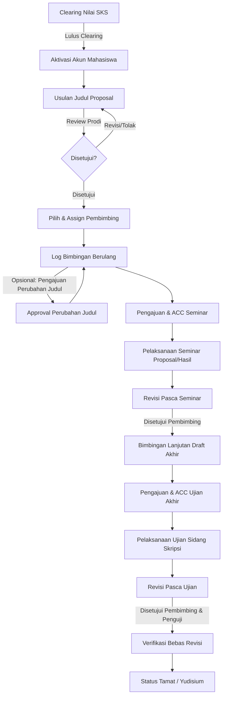
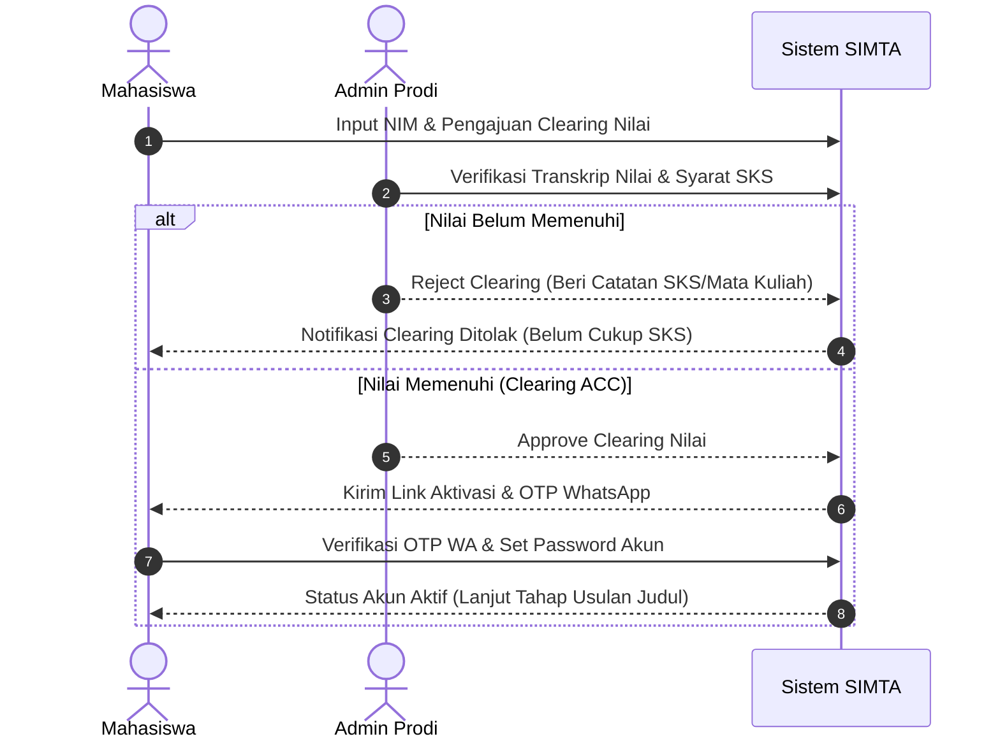
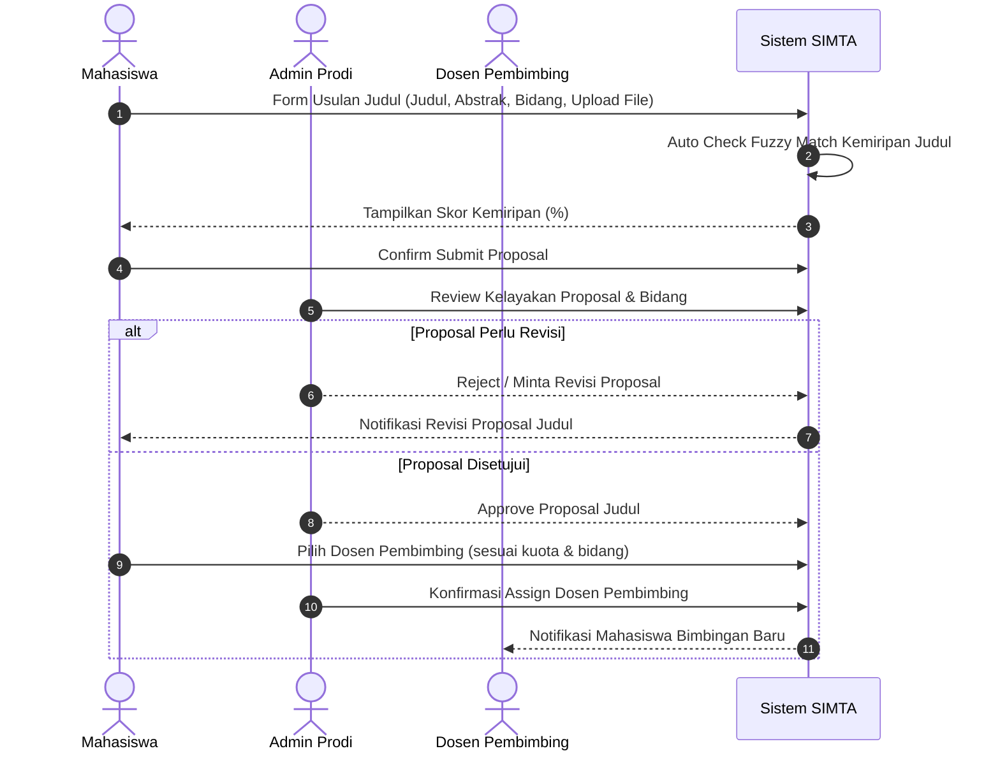
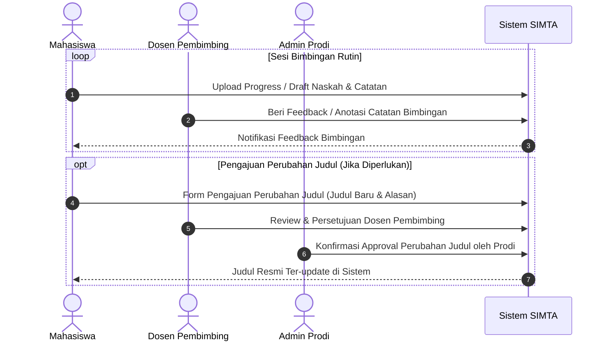
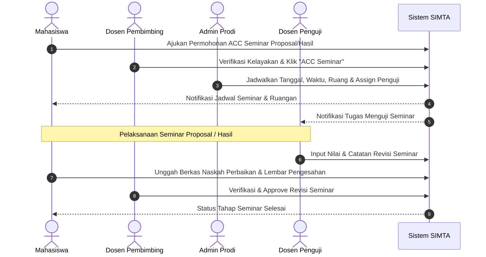
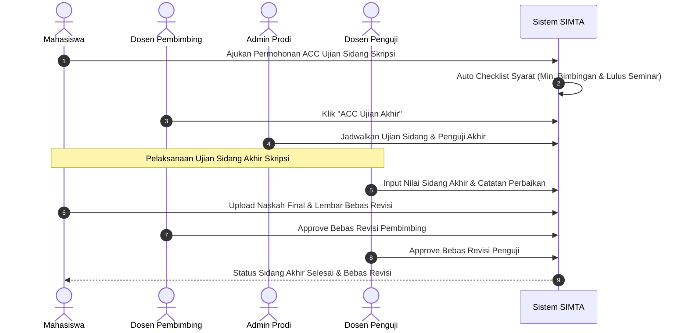
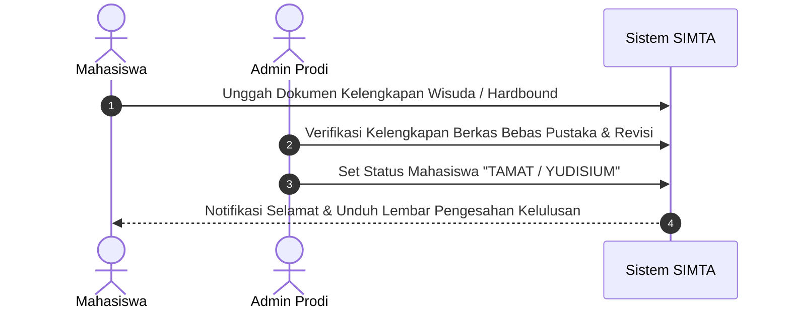

# Workflow & Alur Kerja Detail — SIMTA-Next

Dokumen ini menjelaskan alur kerja (*end-to-end workflow*) dan diagram interaksi (*sequence & flowchart*) untuk setiap tahapan dalam **SIMTA-Next**.

---

## 1. Peta Alur Kerja Utama (Overview Flowchart)

---

## 2. Alur Kerja Detail Per Tahap

### 2.1 Tahap 1: Clearing Nilai & Aktivasi Akun

Mahasiswa hanya bisa mendaftar atau mengaktifkan akun Tugas Akhir setelah verifikasi prasyarat akademik (SKS minimum & IPK).

---

### 2.2 Tahap 2: Usulan Judul Proposal & Penetapan Pembimbing

---

### 2.3 Tahap 3: Log Bimbingan & Pengajuan Perubahan Judul

Selama masa bimbingan, mahasiswa melakukan pencatatan log secara berkala. Jika dalam prosesnya diperlukan penyesuaian judul yang signifikan, fitur pengajuan perubahan judul dapat digunakan.

---

### 2.4 Tahap 4: ACC Seminar, Pelaksanaan, & Revisi Pasca-Seminar

---

### 2.5 Tahap 5: ACC Ujian Akhir, Ujian Sidang, & Revisi Pasca-Ujian

---

### 2.6 Tahap 6: Verifikasi Akhir & Status Tamat (Yudisium)

---

## 3. Matriks Penguncian Akses (State Lock Rules)

Untuk mencegah lompatan alur kerja, setiap modul mengunci aksi tertentu berdasarkan status aktif mahasiswa:

| Status Aktif Mahasiswa | Aksi Terbuka (*Enabled*) | Aksi Terkunci (*Disabled*) |
|---|---|---|
| **Belum Clearing** | Pengajuan clearing nilai SKS | Usulan judul, pilih pembimbing, bimbingan, sidang |
| **Clearing ACC** | Usulan judul proposal | Bimbingan, ACC Seminar, ACC Ujian |
| **Usulan Judul (Review)** | Lihat status proposal | Edit judul (kecuali minta revisi), bimbingan |
| **Bimbingan Aktif** | Log bimbingan, Pengajuan Perubahan Judul | Pengajuan Ujian Akhir (sebelum ACC Seminar) |
| **ACC Seminar** | Lihat jadwal seminar, upload naskah seminar | Pengajuan Ujian Sidang Akhir |
| **Revisi Seminar** | Upload perbaikan naskah seminar | ACC Ujian Akhir (sebelum revisi di-approve) |
| **ACC Ujian Akhir** | Lihat jadwal sidang, upload berkas sidang | Upload berkas wisuda / yudisium |
| **Revisi Ujian Akhir** | Upload naskah final & bukti bebas revisi | Pengubahan data TA |
| **Tamat / Yudisium** | Download lembar pengesahan & sertifikat | Semua form input (Read-only) |
