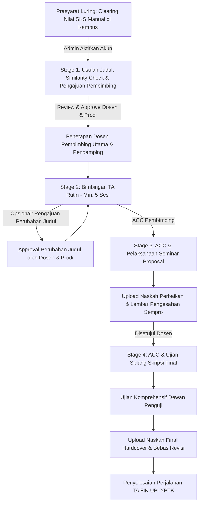
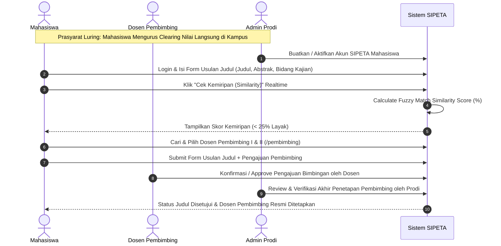
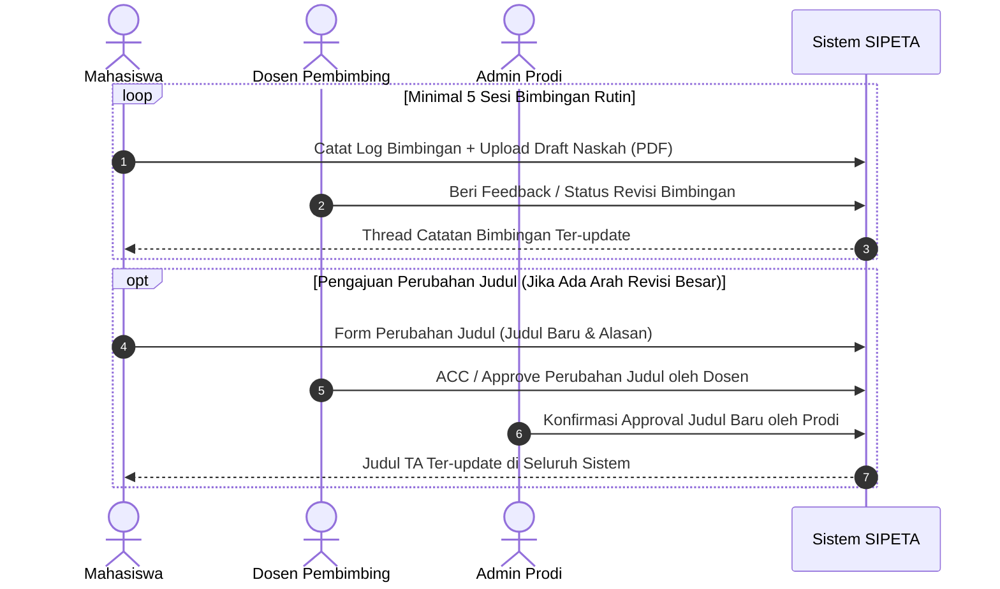
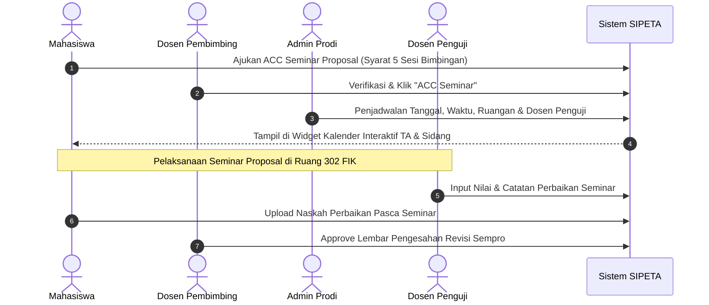
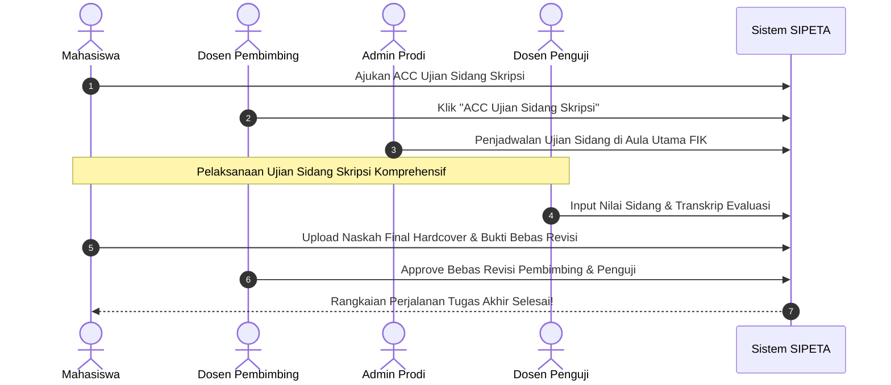

# Workflow & Alur Kerja Detail — SIPETA UPI YPTK Padang

Dokumen ini menjelaskan alur kerja (*end-to-end workflow*) dan diagram interaksi (*sequence & flowchart*) untuk setiap tahapan dalam **SIPETA (Sistem Informasi Perjalanan & Evaluasi Tugas Akhir)**.

---

## 1. Peta Alur Kerja Utama (4 Core TA Workflow)

---

## 2. Alur Kerja Detail Per Tahap

### 2.1 Prasyarat: Clearing Nilai Manual (Luring / Offline di Kampus)
Pengurusan Clearing Nilai SKS & IPK dilakukan mahasiswa secara **manual/langsung di kampus** dengan mendatangi Bagian Akademik / Admin Prodi.  
* **Proses Offline:** Mahasiswa membawa bukti transkrip nilai ke kampus untuk diverifikasi oleh Admin Prodi.  
* **Tidak Ada di Sistem:** Proses pemeriksaan berkas clearing nilai **TIDAK memiliki form / modul input di dalam aplikasi web SIPETA**.  
* **Aktivasi Akun:** Setelah mahasiswa dinyatakan lulus clearing nilai secara luring, Admin Prodi akan membuatkan/mengaktifkan akun SIPETA mahasiswa agar dapat login dan mengusulkan judul TA.

---

### 2.2 Stage 1: Usulan Judul, Cek Kemiripan & Pengajuan Pembimbing

---

### 2.3 Stage 2: Log Bimbingan TA & Pengajuan Perubahan Judul

---

### 2.4 Stage 3: ACC & Pelaksanaan Seminar Proposal

---

### 2.5 Stage 4: Ujian Sidang Skripsi Final

